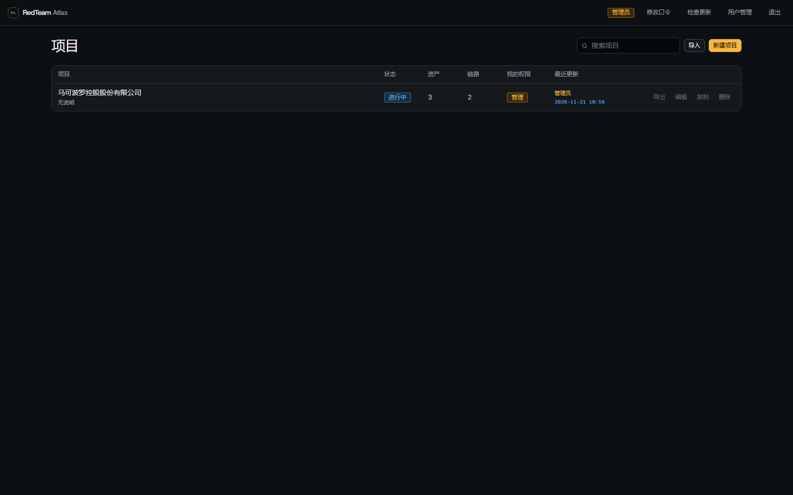
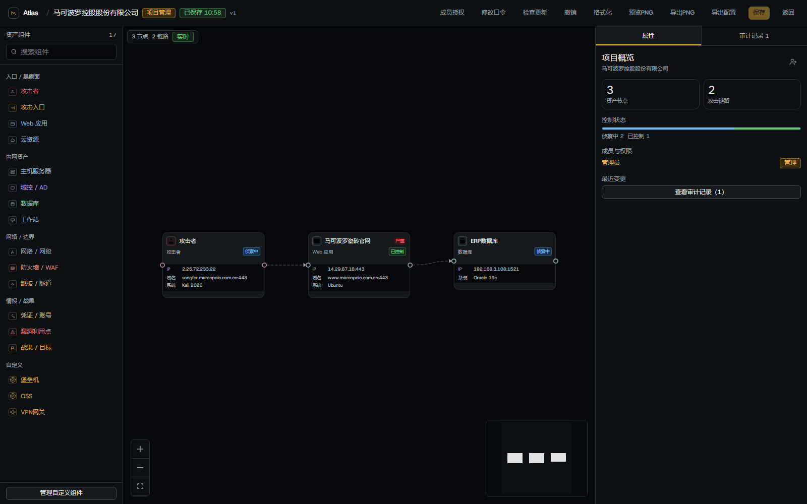
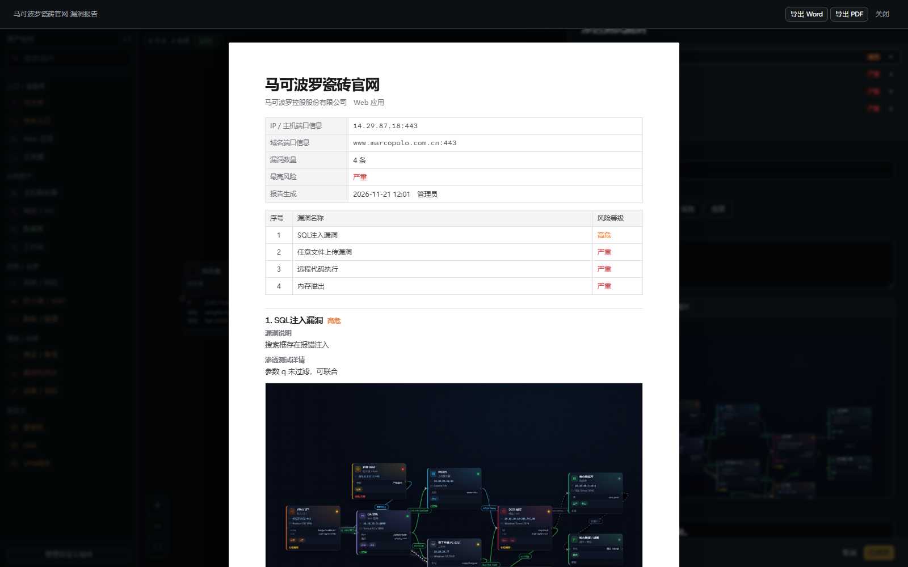

# RedTeam Atlas

红队攻防资产与攻击路径拓扑平台。把渗透过程画成一张可交付的拓扑图——资产属性、漏洞记录、变更审计与渗透报告都在同一个项目里，不再散落在表格与截图之间。

当前版本 3.4.0  [更新日志](CHANGELOG.md)

---

## 主要功能

**项目与状态**：按项目组织工作，每个项目有进行中 / 已完成两种状态，成员按 owner / editor / viewer 三档授权。

**攻击路径画布**：十六种内置资产组件，拖拽到无限画布；节点间拖连接点建立链路。资产属性覆盖 IP、端口、域名、操作系统、自定义字段与四档控制状态。

**漏洞与报告**：一个资产可挂多条漏洞，每条含名称、风险等级、漏洞说明、渗透测试详情（富文本，可插图）与处置建议。报告可预览、导出 Word 与 PDF。

**审计与日志**：每次保存产生字段级审计，记录「谁在什么时候改了哪个对象的哪个字段」；接口访问、运行错误与项目变更各有独立日志文件。

**AI Agent 接入**：内置 MCP 服务端，19 个工具，Agent 可直接读写拓扑。

### 项目列表

按权限过滤的项目清单，含状态、资产数、链路数与最近更新时间。



### 画布

左侧组件库、中间无限画布、右侧属性与审计面板。节点卡片显示地址、状态与自定义字段，链路上可直接标注。



### 渗透测试报告

白底 A4 版面：抬头信息表、漏洞汇总表与逐条详情。预览页里可直接导出 Word 与 PDF。



---

## 主要技术栈

| 层 | 选型 |
| --- | --- |
| 前端 | Vue 3.5、TypeScript 5.7、Vite 6、Pinia 2、Vue Router 4 |
| 画布 | Vue Flow 1.42 |
| 后端 | Rust 2021、axum 0.8、tokio 1 |
| 数据 | SQLite（sqlx 0.8）、AES-256-GCM 加密拓扑 |
| 鉴权 | JWT、argon2 |
| 导出 | html-to-image、jspdf、docx |

## 前端

单页应用，构建产物是静态文件，由后端统一托管，不需要单独的 Nginx。分层为 `types → api → stores → views → components`，三个页面：登录、项目列表、画布。

## 后端

分层为 `router → handler → service → db → model`，统一响应 `{ code, msg, data }`。除登录与正文图片外，所有接口都要求登录。

## 数据

一个数据目录装下全部状态：SQLite 库、加密主密钥、上传文件与日志。拓扑内容用 AES-256-GCM 加密后入库，密钥来自 `ATLAS_SECRET` 或生成的 `secret.key`。

## 鉴权

JWT 默认 7 天，支持 `Bearer` 与 MCP 用的 HTTP Basic 两种。口令策略为至少 8 位且含大小写。管理员可见全部项目，普通成员只看被授权的项目。

## UI

界面遵循 Hallmark 的现代简约方向：深色单页，三个页面各有明确重心；颜色、字号、间距与控件高度全部走设计令牌，不写死颜色；一个主按钮样式，其余为次级与幽灵按钮；控件高度统一，圆角一层一套。

---

## Windows 开发环境部署运行

**前置**：Node.js 22、Rust stable。未装 MSVC 链接器时切 GNU 工具链：

```powershell
rustup install stable-x86_64-pc-windows-gnu
```

**1. 配置**

复制 `.env.example` 为 `.env`。路径必须用正斜杠（`ATLAS_DATA_DIR=D:/atlas-data`）；`dotenvy` 遇到反斜杠或非 ASCII 注释会整份跳过且不报错。

**2. 启动后端**

```powershell
cd backend
$env:RUSTUP_TOOLCHAIN = 'stable-x86_64-pc-windows-gnu'
$env:ATLAS_DIST_DIR = "$PWD\..\frontend\dist"
cargo run
```

监听 `:8080`，启动日志会打印初始管理员口令。

**3. 启动前端**

```powershell
cd frontend
npm install
npm run dev
```

Vite 带热更新，`/api` 与 `/mcp` 代理到 `8080`。

访问终端里打印的地址。

---

## 服务器生产环境 Docker 部署

**1. 准备环境变量**

```bash
cat > .env <<'EOF'
ATLAS_PORT=8080
ATLAS_JWT_SECRET=换成32位以上随机串
ATLAS_SECRET=换成主密钥口令
ATLAS_ADMIN_USER=admin
ATLAS_ADMIN_PASSWORD=换成满足规则的初始口令
EOF
```

`ATLAS_JWT_SECRET` 为空时每次启动随机生成，重启后所有人被登出；`ATLAS_SECRET` 决定拓扑能否解密，换掉等于让历史拓扑不可读。

**2. 构建并启动**

```bash
docker compose build
docker compose up -d
```

**3. 确认**

```bash
docker compose logs -f atlas     # 启动日志里有初始管理员口令
docker compose ps                # 健康状态
```

访问 `http://<服务器IP>:8080`。

数据落在宿主机 `/data/atlas`，由容器入口脚本修正属主后降权运行，目录无需预先创建。

---

## 服务器生产环境 Docker 升级

```bash
# 1. 备份：数据库 + 密钥 + 上传文件，三样缺一不可
docker compose exec atlas tar czf - /data > atlas-backup-$(date +%F).tar.gz

# 2. 取新代码
git pull

# 3. 重建并重启
docker compose build
docker compose up -d

# 4. 确认
docker compose logs -f atlas
```

数据库迁移在启动时自动执行，无需手工跑 SQL。已应用的迁移文件不能再改，要调整就新增一个迁移。

回滚：恢复备份目录后，用上一个镜像重新 `up -d`。

---

## 文档索引

| 文档 | 内容 |
| --- | --- |
| [doc/srs.md](doc/srs.md) | 需求规格：业务模块、70 条功能点、非功能要求、目录结构 |
| [doc/openapi.md](doc/openapi.md) | 接口文档：36 个 REST 接口的参数、返回与错误 |
| [doc/mcp.md](doc/mcp.md) | MCP 接入：握手、鉴权、19 个工具、字段取值与典型工作流 |
| [doc/db.md](doc/db.md) | 数据库：表结构、索引、迁移说明 |
| [CHANGELOG.md](CHANGELOG.md) | 版本更新日志 |